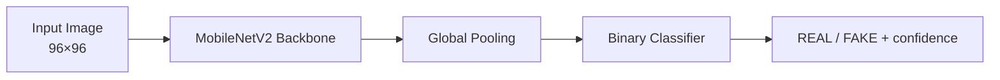

# Real vs AI-Generated Image Detector

Independent research project that trains a lightweight **MobileNetV2** classifier to distinguish real photographs from AI-generated images using the **CIFake** dataset.

> Undergraduate research prototype focused on efficiency, reproducibility, and clear experimental reporting.

---

## Motivation

The rapid improvement of generative models has made synthetic images increasingly difficult to detect by eye. Lightweight, deployable detectors are useful for content moderation, media forensics, and educational tools. This project explores whether a compact CNN (MobileNetV2) can achieve strong performance on a standard real/fake benchmark while remaining practical on modest hardware.

## Problem Statement

Given an RGB image, classify it as **REAL** or **FAKE** (AI-generated). The system should be:

- Accurate on a held-out test set
- Lightweight enough for CPU inference
- Reproducible (fixed seeds, documented splits and hyperparameters)

## Research Objectives

1. Train a MobileNetV2-based binary classifier on the CIFake dataset.
2. Evaluate on the official held-out test split (20 000 images).
3. Document training methodology, hyperparameters, and limitations.
4. Provide a minimal interactive demo for qualitative inspection.

## Dataset

**CIFake** (Real and AI-Generated Synthetic Images)  
Source: [Kaggle – birdy654/cifake-real-and-ai-generated-synthetic-images](https://www.kaggle.com/datasets/birdy654/cifake-real-and-ai-generated-synthetic-images)

| Split | REAL | FAKE | Total |
|-------|------|------|-------|
| Train | 50 000 | 50 000 | 100 000 |
| Test  | 10 000 | 10 000 | 20 000  |

Images are resized to **96 × 96** for the lightweight training regime used in this work. The official train/test split is respected; no test images are used for training or model selection.

**Important:** Do not commit the dataset or Kaggle credentials. Download the dataset yourself using a personal Kaggle API token (never hard-code keys).

## Model Architecture

- Backbone: MobileNetV2 (ImageNet pretrained weights via `timm`)
- Input resolution: 96 × 96
- Classification head: binary (REAL / FAKE)
- Training strategy: two-phase transfer learning (freeze backbone → fine-tune)
- Optional test-time augmentation (TTA) mentioned in the experimental notebook



## Experimental Setup (from notebook)

| Setting              | Value                          |
|----------------------|--------------------------------|
| Framework            | PyTorch                        |
| Backbone             | MobileNetV2 (timm)             |
| Image size           | 96 × 96                        |
| Batch size           | 32                             |
| Epochs               | Phase 1 = 3, Phase 2 = 8       |
| Random seed          | 42                             |
| Device               | CUDA when available            |
| Augmentations        | Albumentations pipeline        |

Exact training and evaluation commands, full hyperparameter lists, and measured metrics will be expanded as experiment logs are consolidated.

## Results Status

The notebook states an expected accuracy range of approximately **97–98 %** under the described lightweight regime.  
**Final measured metrics (accuracy, precision, recall, F1, ROC-AUC, parameter count, latency) must be taken from the actual evaluation cell outputs of a completed run.**  
Until those numbers are extracted and verified from a clean run, treat published figures as provisional.

A proper results table, confusion matrix, ROC curve, and ablation notes will be added once verified experimental artifacts are available.

## Limitations

- Evaluation is currently limited to the CIFake test split; external dataset generalization has not yet been reported.
- 96 × 96 resolution discards fine-grained detail that larger models may exploit.
- No adversarial robustness or out-of-distribution analysis is included in the present version.
- Model weights and full experiment logs are not yet packaged for one-click reproduction.

## Future Work

- Publish verified metrics with confidence intervals.
- External dataset evaluation (e.g., other synthetic-image benchmarks).
- Ablations on Mixup, TTA, and resolution.
- Model card with intended use, risks, and out-of-scope applications.
- Lightweight export (ONNX / TorchScript) and measured CPU/GPU latency.

## Installation & Reproduction

```bash
# Clone
git clone https://github.com/zafaraieng/Real-and-Fake_image_detector.git
cd Real-and-Fake_image_detector

# Python environment (recommended)
python -m venv .venv
source .venv/bin/activate   # or Windows equivalent
pip install -r requirements.txt   # to be added

# Kaggle credentials (never commit these)
# Place kaggle.json in ~/.kaggle/ or set KAGGLE_USERNAME / KAGGLE_KEY as environment variables

# Open the research notebook
jupyter notebook notebooks/Real\&Fake_image_detector.ipynb
```

Demo UI (optional):

```bash
npm install
npm run dev
```

## Project Structure

```
├── notebooks/                  # Research notebook(s)
├── src/                        # Demo frontend (Vite + React)
├── README.md
├── .gitignore
└── package.json                # Demo UI only
```

Further separation into `src/`, `scripts/`, `configs/`, and `tests/` is planned.

## Security Note

Never commit API keys, Kaggle tokens, or `.env` files.  
Rotate any key that has ever appeared in a public commit or notebook cell.

## License

To be determined after reviewing dataset and dependency licenses.  
Code is currently provided for research and educational purposes.

## Citation

If you use this work, please cite the repository and the original CIFake dataset authors.

---

*Undergraduate independent research project. Feedback and collaboration welcome.*
